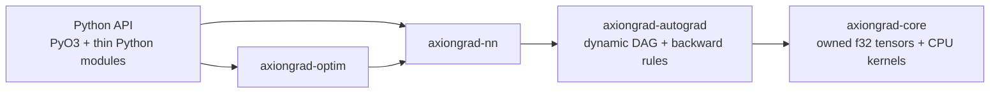

<p align="center">
  
</p>

# AxionGrad

AxionGrad is a small, from-scratch deep-learning framework with a safe Rust CPU
engine and an ergonomic Python API. It implements its own tensors, dense
kernels, dynamic reverse-mode autograd, layers, losses, and optimizers. It does
not execute through PyTorch, TensorFlow, JAX, Burn, Candle, or `ndarray`.

AxionGrad is experimental and optimized for learning, inspection, and
correctness work—not production deployment or performance claims.

## Verified snapshot

- Centered finite-difference checks cover composed arithmetic and stable
  cross-entropy gradients.
- Shared graph nodes, branching, repeated backward calls, and broadcast-gradient
  reduction are tested.
- A deterministic AxionGrad-only XOR MLP reaches 100% accuracy: loss
  `0.253895432 -> 0.000003317` with seed 7. See the
  [recorded metrics](examples/metrics/xor-seed-7.json).
- MNIST MLP code is implemented for local IDX files, but no unrun MNIST metric
  is claimed.

## Quick start

Stable Rust 1.85+ and Python 3.12+ are required.

```bash
python -m venv .venv
. .venv/bin/activate
python -m pip install maturin pytest
maturin develop

python - <<'PY'
import axiongrad as ag

x = ag.tensor([1.0, 2.0, 3.0], requires_grad=True)
y = x * x
y.sum().backward()
print(x.grad.data)  # [2.0, 4.0, 6.0]
PY
```

Training uses familiar module and optimizer boundaries:

```python
import axiongrad as ag

model = ag.nn.Sequential(
    ag.nn.Linear(2, 8, seed=7),
    ag.nn.Tanh(),
    ag.nn.Linear(8, 1, seed=8),
    ag.nn.Sigmoid(),
)
optimizer = ag.optim.Adam(model.parameters(), learning_rate=0.05)
```

## Architecture



Core owns numerical storage and kernels. Autograd adds result-to-parent graph
edges and local derivative rules. NN owns shared trainable parameter handles;
optimizers replace their immutable leaf variables after each update. Details
are in [ARCHITECTURE.md](ARCHITECTURE.md).

## Feature matrix

| Capability | Status | Notes |
|---|---:|---|
| Owned contiguous CPU `f32` tensors | ✅ | Row-major, safe Rust |
| Shape/stride metadata and checked indexing | ✅ | Scalar and zero-sized shapes tested |
| Broadcasting and basic arithmetic | ✅ | Forward and gradient reduction |
| Reshape and transpose | ✅ | Transpose materializes contiguous output |
| 2-D matmul, full sum/mean | ✅ | No batched matmul or axis reduction yet |
| Reverse-mode autograd | ✅ | Dynamic DAG, accumulation, shared nodes |
| Linear/ReLU/Sigmoid/Tanh/Sequential | ✅ | Deterministic Xavier initialization |
| MSE and softmax cross-entropy | ✅ | Stable log-sum-exp cross-entropy |
| SGD and Adam | ✅ | Dense parameters |
| Python bindings and type hints | ✅ | PyO3 extension, Python NN/optimizer API |
| XOR training | ✅ verified | Rust and Python convergence tests |
| MNIST MLP | 🟡 implemented | Requires local IDX data; result not claimed |
| Serialization, convolution, pooling | ❌ | Planned |
| Additional dtypes, GPU, distributed | ❌ | Deliberately deferred |

## Examples

```bash
cargo run --release -p axiongrad-examples --bin linear_regression
cargo run --release -p axiongrad-examples --bin binary_classification
cargo run --release -p axiongrad-examples --bin xor
cargo run --release -p axiongrad-examples --bin mnist -- \
  train-images-idx3-ubyte train-labels-idx1-ubyte 5 60000
```

See [the training guide](docs/training.md) for architectures, inputs, and
evidence boundaries.

## Validation

```bash
cargo fmt --all --check
cargo clippy --workspace --all-targets -- -D warnings
cargo test --workspace --locked
maturin develop
pytest -q
```

CI runs the same Rust checks, Python 3.12 tests, and the release XOR example.
PyTorch is not required; if introduced later, it may only be an optional test
oracle.

## Repository map

```text
crates/axiongrad-core       tensors and CPU kernels
crates/axiongrad-autograd   graph construction and backward rules
crates/axiongrad-nn         parameters, modules, initialization, losses
crates/axiongrad-optim      SGD and Adam
crates/axiongrad-python     native PyO3 tensor bindings
python/axiongrad            ergonomic Python NN and optimizer surface
examples                    verified XOR and IDX MNIST binaries
docs                        architecture, training, support, completion evidence
assets                      original AxionGrad SVG identity
```

## Project policy

- [Supported operations](docs/supported-operations.md)
- [Security notes](SECURITY.md)
- [Contribution and test requirements](CONTRIBUTING.md)
- [Roadmap](ROADMAP.md)
- [Completion and release checklist](docs/COMPLETION_REPORT.md)

Benchmark claims require matched hardware, datatype, tensor shapes, warmup,
sampling methodology, and reproducible code. None are made in this release.

